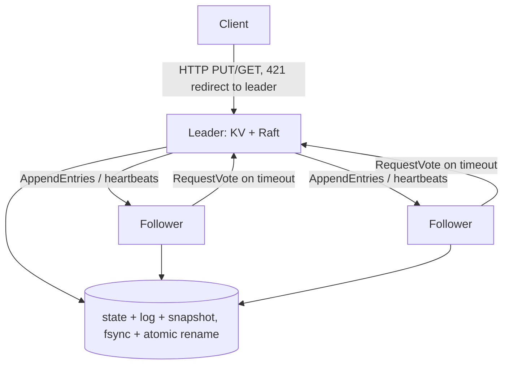

# Raft KV Store

**A linearizable, replicated key-value store on Raft consensus, implemented from scratch in Go: leader election, log replication, snapshots, ReadIndex reads, and fault-injection tests.**

 [](https://github.com/Alkarim786/raft-kv-store/actions/workflows/ci.yml) [](LICENSE)

## Why
A single database node is a single point of failure. Raft keeps a cluster of 2f+1 nodes correct and available while any f of them crash or are partitioned. Every write is committed by a majority, and every read reflects every completed write (linearizability). No etcd/raft or hashicorp/raft library is used.

## Architecture

- **Write:** `Start(op)` → replicate → majority commit → apply to the map → reply.
- **Read:** ReadIndex. Record commitIndex, confirm leadership with one heartbeat round, wait until applied, then read. No log write.

## Features
- **Elections:** randomized timeouts, vote persistence, and the up-to-date log check.
- **Replication:** fast conflict backtracking (conflict term/index), Figure-8 safe commit (only current-term entries commit by counting), and a leader no-op on election.
- **Persistence and snapshots:** atomic fsync+rename file storage; crash-safe snapshot files named by index; InstallSnapshot for lagging followers; group commit on the leader.
- **KV layer:** Put/Get/Delete/CAS with exactly-once retries via (clientID, seq) sessions. Snapshots are taken when Raft state passes `SNAPSHOT_BYTES`.
- **Transport and client:** HTTP+JSON. A Go client follows leader redirects and retries.
- **Testing and tooling:** an in-memory network with drop, delay, reorder and partitions; a 3-node Docker Compose cluster; `kvbench` for write, read and failover benchmarks.

**Roadmap:** segmented append-only WAL (the current storage rewrites the whole log per persist), batched ReadIndex, membership changes (joint consensus), pre-vote, gRPC transport.

## Key decisions
- Persist before replying to any RPC. Followers fsync in the AppendEntries handler; the leader counts itself toward a majority only for entries it has fsynced.
- **Bug found by tests:** each node's election RNG was seeded from the clock. On Windows, nodes created in the same clock tick got identical timeouts, so every election split forever. It's now seeded from `crypto/rand`, with a regression test.
- **Bug found by an e2e test:** a stopped or isolated leader kept pointing clients at itself. Stopped nodes now report no leader, and the client ignores self-redirects.

## Quick start
```bash
docker compose up --build -d
curl -X PUT -d hello localhost:8001/kv/greeting   # any node; followers answer 421 + leader URL
curl localhost:8001/status
docker compose run --rm bench -mode write -c 32 -d 15s
```
**API:** `GET/PUT/DELETE /kv/{key}`, `POST /kv/{key}/cas {"expect","value"}`, `GET /status`. Writes accept `X-Client-ID` and `X-Seq` headers for exactly-once retries.

## Testing
```bash
go test -race ./...
```
23 tests:
- **Raft:** election, re-election, 7-node churn, majority-only commit, conflicting-log rejoin, fast backup over 50 divergent entries, full-cluster restarts, Figure 8 on an unreliable network (10% loss, delays, crashes), snapshot install to a lagging follower, snapshot restart, ReadIndex on an isolated leader, election-timeout regression.
- **KV:** CAS and duplicate-submit exactly-once, bounded state via snapshots, **porcupine linearizability check: 10,675 operations under partitions and crashes, result Ok**, HTTP end-to-end with leader failover.

## Benchmarks
Measured 2026-10-19 on an AMD Ryzen 5 7520U (4C/8T), 16 GB RAM, Windows 11. The 3-node cluster and the benchmark client ran in Docker Desktop (WSL2) on that same laptop. Every write was fsynced on a majority.

| Test | Result |
|---|---|
| Writes (32 clients, 15 s) | **688 ops/s**, p50 45 ms, p99 87 ms, 0 errors |
| Linearizable reads via ReadIndex (32 clients, 15 s) | **3,244 ops/s**, p50 8.6 ms, p99 30 ms, 0 errors |
| Failover: leader killed during writes (8 clients) | longest write gap **1.38 s**, **0 failed writes**; new leader elected; the killed node rejoined and caught up to index 14,328 |

## Structure
`raft/` (consensus, storage, in-memory fault network, tests) · `kv/` (state machine, HTTP API, linearizability tests) · `transport/` (HTTP RPC) · `client/` · `cmd/kvnode`, `cmd/kvbench` · `docker-compose.yml`

## License
[MIT](LICENSE) © Karim (Alkarim786)
